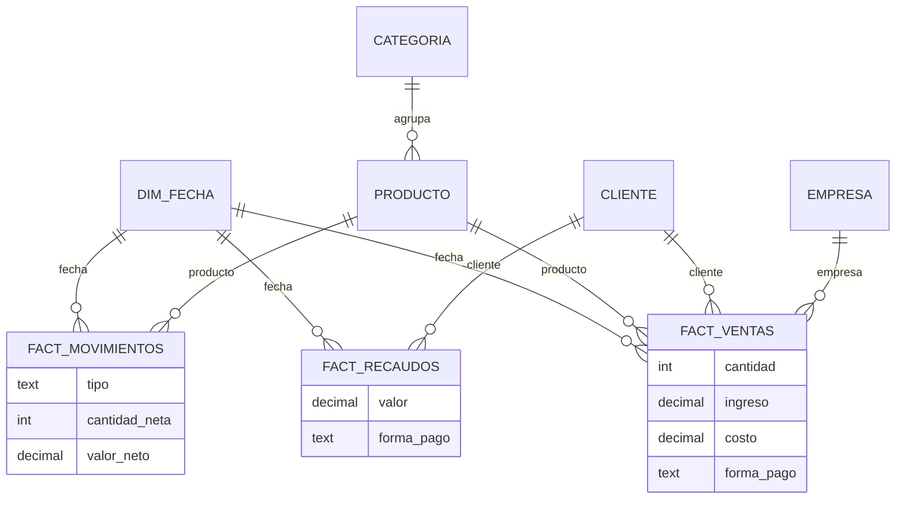

# PAGE-PYME

Plataforma de gestión y analítica para pymes comercializadoras de elementos de protección personal (EPP). Centraliza ventas, inventario y cartera, y convierte esos registros en un tablero de control con seis indicadores de negocio.

Desarrollada como prototipo funcional del trabajo de grado *Diseño de un sistema de indicadores y dashboards para la toma de decisiones en pymes* (Maestría en Analítica de Datos, Universidad Central).

## Módulos

| Módulo | Qué hace |
|---|---|
| Maestros | Productos, categorías (con meta de margen propia) y clientes (con plazo de crédito). |
| Importación | Carga desde Excel o CSV en dos pasos: análisis y validación, y luego confirmación. Cada carga queda registrada. |
| Comercial | Cotizaciones, ventas de contado y a crédito, abonos, anulaciones y cartera por antigüedad. |
| Inventario | Entradas por compra, ajustes con motivo, salidas automáticas por venta y alertas de stock mínimo. Costo promedio ponderado. |
| Tablero de control | Seis indicadores con meta, cumplimiento, estado, variación frente al periodo anterior, fórmula y decisión que apoyan; gráficas de tendencia, cartera y contribución; acciones sugeridas. |
| Evidencia del piloto | Calidad de datos, bitácora de uso, encuesta SUS, exportación a Excel y resumen consolidado del piloto (equipo consultor). |

Roles: **gerente** (todo), **comercial** (tablero, clientes, cotizaciones, ventas y cartera) y **bodega** (productos, movimientos y alertas). Cada usuario ve solo los datos de su empresa.

## Arquitectura

```
Registro operativo (Django + PostgreSQL)
  maestros_* · comercial_* · inventario_*        ← tablas transaccionales normalizadas
          │
          ▼
Capa analítica (esquema en estrella, vistas SQL de solo lectura)
  analitica_dimfecha            dimensión de tiempo (calendario 2024–2032)
  analitica_fact_ventas         una fila por línea de venta emitida
  analitica_fact_movimientos    una fila por movimiento de inventario (cantidad con signo)
  analitica_fact_recaudos       una fila por abono
          │
          ▼
Servicio de indicadores (analitica/indicadores.py)
          │
          ▼
Tablero de control · exportación · resumen del piloto
```



Las vistas usan solo SQL estándar, por lo que el mismo esquema funciona en PostgreSQL (producción) y SQLite (desarrollo). Cualquier herramienta de BI (Metabase, Superset, Power BI) puede conectarse directamente a estas vistas.

## Indicadores

| Indicador | Fórmula | Meta por defecto |
|---|---|---|
| Rotación de inventario | (Costo de la mercancía vendida ÷ inventario promedio a costo) × (365 ÷ días del periodo) | ≥ 4 veces/año |
| Margen de contribución | (Ventas − costo de la mercancía vendida) ÷ ventas × 100 | ≥ 30 % |
| Días de cartera (DSO) | (Saldo de cartera al cierre ÷ ventas a crédito del periodo) × días del periodo | ≤ 30 días |
| Quiebres de stock | Productos activos con existencia 0 al cierre ÷ productos activos × 100 | ≤ 5 % |
| Ticket promedio | Ventas del periodo ÷ número de ventas | Definida por la empresa |
| Clientes recurrentes | Clientes con 2 o más compras ÷ clientes que compraron × 100 | ≥ 40 % |

Regla única de estado: **cumplimiento** = valor ÷ meta × 100 (si mejora al subir) o meta ÷ valor × 100 (si mejora al bajar). *Cumple* si alcanza la meta; *En riesgo* si no la alcanza con cumplimiento ≥ 90 %; *Crítico* por debajo de 90 %. Las ventas anuladas no se cuentan.

## Calidad de los datos

Al importar: columnas obligatorias, tipos numéricos (formatos 12.000 · 12.000,50 · $ 1.234), valores no negativos, duplicados dentro del archivo, registros existentes (se actualizan) y clientes con nombre parecido. En operación: el stock nunca queda negativo, el costo de cada venta se guarda con el costo promedio del momento y el panel «Calidad de datos» comprueba integridad (stock frente a movimientos, total de la venta frente a sus líneas), completitud y oportunidad del registro.

## Ejecutar en local

```bash
python -m venv .venv && source .venv/bin/activate
pip install -r requirements.txt
python manage.py migrate
python manage.py cargar_demo          # empresa con datos ficticios
python manage.py createsuperuser      # usuario del equipo consultor
python manage.py runserver
```

Sin `DATABASE_URL` se usa SQLite. Usuarios de demostración: `demo.gerente`, `demo.comercial`, `demo.bodega` (contraseña en la variable `DEMO_CLAVE`, por defecto `Demo-PagePyme-2026`).

Pruebas automáticas (indicadores contra cálculos manuales, importación, reglas de inventario, permisos y SUS):

```bash
python manage.py test
```

## Despliegue gratuito (Render + Neon)

1. **Base de datos (Neon):** crear un proyecto en la región *AWS US East (N. Virginia)* y copiar la cadena de conexión.
2. **Aplicación (Render):** *New → Blueprint*, seleccionar este repositorio. Render lee `render.yaml` y pide:
   - `DATABASE_URL`: la cadena de Neon.
   - `DJANGO_SUPERUSER_USERNAME` y `DJANGO_SUPERUSER_PASSWORD`: usuario del equipo consultor.
3. Al terminar la construcción la aplicación queda en `https://<nombre>.onrender.com`.

El plan gratuito de Render suspende el servicio tras 15 minutos sin visitas; la primera visita después tarda cerca de un minuto en responder. Para recrear la empresa de demostración en un despliegue, definir `REINICIAR_DEMO=1`.

## Vincular una empresa del piloto

1. Ingresar como consultor → *Administración → Empresas → Agregar* (dejar sin marcar «Empresa de demostración»).
2. *Administración → Usuarios* y *Perfiles*: crear el usuario gerente y asociarlo a la empresa con rol *Gerente*.
3. El gerente completa *Datos de la empresa*, importa sus archivos de Excel y crea los usuarios de su equipo.

## Licencias de terceros

Chart.js (MIT) y la tipografía IBM Plex Sans (SIL Open Font License 1.1, ver `static/fonts/`).
